# LowenKIDS-StrainDynamics
Bioinformatic and phylogenetic pipeline (R, Python, ETE 3) analyzing strain-level genetic distances, longitudinal persistence/turnover, and household transmission across 932 gut microbiome SGBs in the LöwenKIDS cohort using StrainPhlAn4 outputs.

```mermaid
flowchart LR
    %% ==================== TIER 1: INGESTION, QC & METADATA ====================
    subgraph T1["Tier 1 — Data Ingestion, QC & Master Matrix (932 SGBs)"]
        direction TB
        M1["<b>M1: Raw Input Inventory (Bash)</b><br/>932 SGB folders (t__SGB*_tree/): RAxML_bestTree.tre, .aln, .mutation, .polymorphic, .info, _mutation_rates<br/>Cohort metadata (intersect_timestamp_household_Syafiq_05022026.tsv) & CHOCOPhlAn taxonomy"]
        M2["<b>M2: Alignment & Count Audit (R / Bash)</b><br/>Exact '*concatenated.aln' files (exclude '*.aln.reduced') · Strip '>' & '_filtered' from sample IDs<br/>Reconcile sample counts across .polymorphic, .mutation & .aln · Extract marker count, L_aln & mutation rates"]
        M3["<b>M3: Taxonomy & Metadata Join (R dplyr)</b><br/>Strip 't__' & resolve '_group' fallback against CHOCOPhlAn (verify 0 NAs)<br/>Join samples with household_id, timestamp & role ('Kid') · Compute n_households & n_kids_multi_hh (&gt;1 sample in .aln)"]
        M4["<b>M4: Power & Coverage Stratification (R)</b><br/>Tier A: All 932 SGBs · Tier B: n_aln &gt;= 10 &amp; n_households &gt;= 3 · Tier C: n_kids_multi_hh &gt;= 3 &amp; Δt &gt; 0<br/>Flag technical replicates (Δt = 0, same subject)"]
        M1 --> M2 --> M3 --> M4
    end

    %% ==================== TIER 2: DISTANCES & ETE 3 ====================
    subgraph T2["Tier 2 — Pairwise Distances, Polymorphism & ETE 3 Phylogenetics"]
        direction TB
        M5["<b>M5: Mutation Matrix Melt (Python / pandas)</b><br/>Unpivot *.mutation upper triangle into n(n-1)/2 pairs (i, j) for d_mut(i, j)<br/>Cross-check against direct SNP / Hamming distance d_aln(i, j) from *concatenated.aln"]
        M6["<b>M6: Polymorphism QC (Python / R)</b><br/>Parse percentage_of_polymorphic_sites (P_poly) &amp; marker stats from *.polymorphic<br/>Flag high-diversity / multi-strain samples (P_poly &gt; Q3 + 1.5·IQR)"]
        M7["<b>M7: ETE 3 Patristic Engine (Python / ete3)</b><br/>Load RAxML_bestTree.t__SGB*.tre, strip '_filtered' &amp; apply midpoint rooting<br/>Compute patristic distance d_pat(i, j) &amp; Spearman correlation ρ(d_mut, d_pat) per SGB"]
        M8["<b>M8: ETE 3 Topology & Clades (Python / ete3)</b><br/>Extract terminal branch lengths l_term &amp; nearest-neighbor household match rate NN_HH<br/>Test household/subject monophyly &amp; clade clustering · Audit RAxML_info model stats"]
        M5 --> M6 --> M7 --> M8
    end

    %% ==================== TIER 3: PAIRS & CUTOFF CALIBRATION ====================
    subgraph T3["Tier 3 — Relational Pair Taxonomy & Cutoff Calibration"]
        direction TB
        M9["<b>M9: Relational Pair Taxonomy (Python / R)</b><br/>Classify pairs by household (Within-HH W_s vs Between-HH B_s), time (Δt = 0 vs Δt &gt; 0)<br/>and host roles (Kid-Kid longitudinal, Kid-Co-resident, Adult-Adult, Inter-HH)"]
        M10["<b>M10: Strain Cutoff τ Calibration (R / Python)</b><br/>Calibrate τ_mut &amp; τ_pat from W_s vs B_s distributions · Indicator S_ij(τ): d_mut &lt;= τ_mut &amp; d_pat &lt;= τ_pat<br/>Sensitivity sweep across τ grid (0.001, 0.002, 0.005, 0.01, 0.02)"]
        M11["<b>M11: Evolutionary Rate Context (R / Python)</b><br/>Use *_mutation_rates (μ_s) &amp; Δt to model neutral drift E[d(Δt)] = μ_s · Δt + d_0<br/>Compute excess divergence Δd_excess = d_obs - E[d(Δt)] to separate drift vs turnover"]
        M9 --> M10 --> M11
    end

    %% ==================== TIER 4: QUESTION 1 (LONGITUDINAL) ====================
    subgraph T4["Tier 4 — Q1: How Strains Stay in One Subject Over Time or Change?"]
        direction TB
        Q1_1["<b>Q1.1: Consecutive Transitions (Python / R)</b><br/>Order samples m_1 -&gt; ... -&gt; m_k per subject/Kid HH · Persistence: d(m_r, m_{r+1}) &lt;= τ<br/>Replacement (turnover): d(m_r, m_{r+1}) &gt; τ · Compute Persistence Rate PR_s &amp; Turnover TR_s"]
        Q1_2["<b>Q1.2: Resurgence vs. Re-colonization (Python / R)</b><br/>Detect .aln absences at intermediate timepoints (t_1 present, t_mid absent, t_3 present)<br/>Resurgence: d(m_{t1}, m_{t3}) &lt;= τ (same strain returns) vs Re-colonization: d(m_{t1}, m_{t3}) &gt; τ"]
        Q1_3["<b>Q1.3: Time-Decay &amp; Survival (R lme4 / survival)</b><br/>Mixed model d_ij ~ β_0 + β_1·Δt_ij + (1|HH) + (1|SGB) · Spearman ρ(d_mut, Δt)<br/>Kaplan-Meier strain retention curves &amp; strain half-life t_1/2 per SGB"]
        Q1_4["<b>Q1.4: In-Host Evolution vs. Co-colonization (Python / R)</b><br/>Estimate within-strain SNV rate r_inhost = d_mut / Δt across persistent pairs<br/>Test whether elevated polymorphism P_poly precedes strain replacement events"]
        Q1_1 --> Q1_2 --> Q1_3 --> Q1_4
    end

    %% ==================== TIER 5: QUESTION 2 (HOUSEHOLDS) ====================
    subgraph T5["Tier 5 — Q2: How Similar or Different Are Strains Between Households?"]
        direction TB
        Q2_1["<b>Q2.1: Within- vs. Between-HH Tests (R / scipy)</b><br/>Mann-Whitney U test + 9,999 household_id label permutations per SGB (BH-FDR q-values)<br/>Effect sizes: Median Delta Δ_med = med(B_s) - med(W_s), Ratio R_med &amp; Cliff's delta δ"]
        Q2_2["<b>Q2.2: Shared-Strain &amp; Transmission Rates (R / Python)</b><br/>Sharing probabilities P_intra(s) vs P_inter(s) under cutoff τ · Enrichment odds ratio OR_HH(s)<br/>Stratify by matched vs unmatched timestamps (Δt) to control time confounding"]
        Q2_3["<b>Q2.3: Role-Stratified Household Network (R igraph / dplyr)</b><br/>Decompose within-HH pairs by role: Kid-Parent, Kid-Sibling, Adult-Adult<br/>Contrast vertical vs horizontal sharing &amp; test household size / Kid age effects"]
        Q2_4["<b>Q2.4: Phylogenetic HH Clustering (Python / ete3)</b><br/>Replicate W_s vs B_s comparisons on ETE 3 patristic distances d_pat<br/>Quantify monophyletic / sub-threshold HH clades &amp; phylogenetic household signal"]
        Q2_1 --> Q2_2 --> Q2_3 --> Q2_4
    end

    %% ==================== TIER 6: SYNTHESIS & DELIVERABLES ====================
    subgraph T6["Tier 6 — Cross-SGB Synthesis (932 SGBs) & Thesis Deliverables"]
        direction TB
        S1["<b>S1: Master 932-SGB Synthesis Matrix (R / Python)</b><br/>Unified 932-row table combining coverage (N_aln, n_households, n_kids_multi_hh), Q1 (PR_s, TR_s, R_res, t_1/2),<br/>Q2 (Δ_med, R_med, δ, q_FDR, OR_HH), ETE 3 metrics (ρ(d_mut, d_pat), NN_HH), μ_s &amp; P_poly"]
        S2["<b>S2: 4-Quadrant Ecological Typology (R ggplot2)</b><br/>Classify SGBs across (PR_s, OR_HH): Persistent &amp; Family-Shared, Persistent &amp; Independent,<br/>Transient &amp; Family-Shared, and Transient &amp; Dispersed · Rank top SGBs per profile"]
        S3["<b>S3: Taxonomic &amp; Genomic Predictors (R stats / vegan)</b><br/>Compare Q1 &amp; Q2 across Phylum, Family &amp; Genus · Test genomic predictors (μ_s, P_poly, marker count, prevalence)"]
        S4["<b>S4: Robustness &amp; Thesis Deliverables (R / Python / PPTX)</b><br/>Sensitivity across τ grid, Tiers A/B/C &amp; .mutation vs ETE 3 · Reproducible Git repo, figures &amp; HZI presentation deck"]
        S1 --> S2 --> S3 --> S4
    end

    %% ==================== CONNECTIONS BETWEEN TIERS ====================
    M4 --> M5
    M4 --> M7
    M6 --> M9
    M8 --> M9
    M11 --> Q1_1
    M11 --> Q2_1
    Q1_4 --> S1
    Q2_4 --> S1
```

